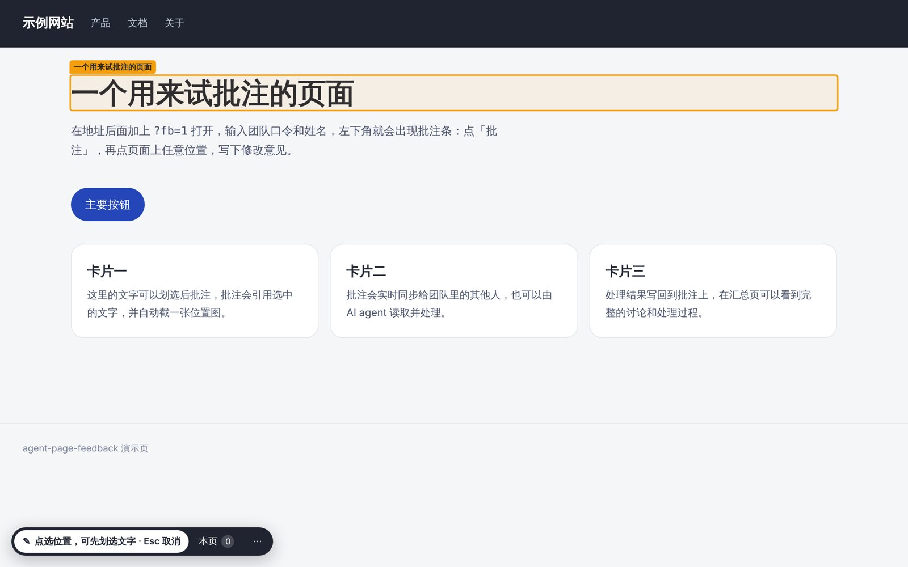
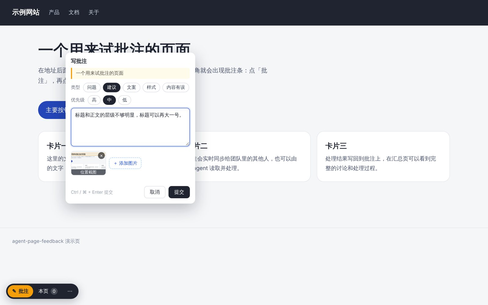
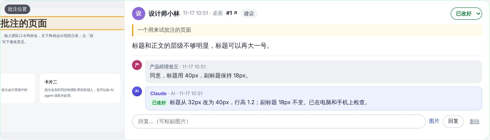
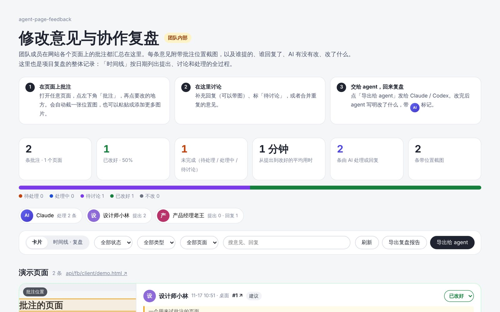
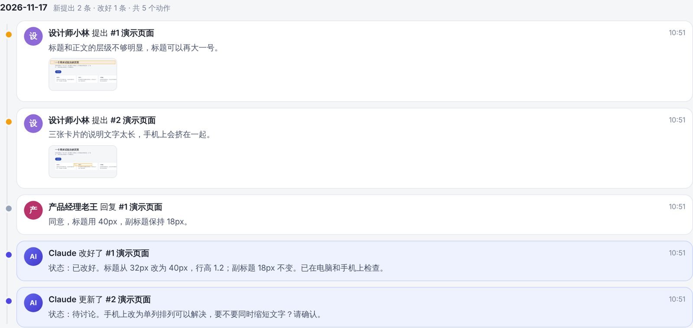
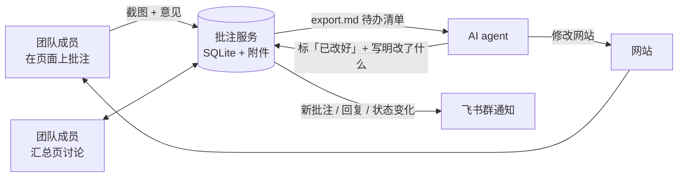

# agent-page-feedback

**让多个人和 AI agent 在同一个网站上协作改版：人在页面上圈出问题、写意见，agent 读取、修改、回写，全过程可以复盘。**

*Page annotations shared by people and AI agents: click anywhere on your site to leave feedback with an automatic screenshot; agents read the queue over a plain HTTP API, fix things, and write back — every step is kept for review.*



## 它解决什么问题

网站交给 agent（Claude、Codex……）开发以后，团队的修改意见常常散落在聊天记录里：说不清是哪个位置，agent 看不到截图，改没改、怎么改的也查不到。这个项目把这件事变成一个固定流程：

1. **在页面上批注**：点左下角「批注」，再点页面上要改的地方（可以先划选一段文字）。会**自动截一张位置图**，用橙色框标出点选的元素；还可以粘贴或添加更多图片。
2. **大家一起讨论**：所有批注存在服务器上，团队成员都能看到、回复（可以带图）、改状态。
3. **agent 读取并修改**：agent 用一个 HTTP 接口拿到「待办清单」（Markdown，带页面地址、定位信息、截图地址和讨论记录），改完后把那条批注标为「已改好」并写明改了什么。
4. **汇总与复盘**：汇总页按页面列出全部意见（左边截图、右边对话，AI 的回复单独标出），还有按日期的「时间线 · 复盘」视图，一键导出复盘报告。

| 写批注时自动截图 | 汇总页：截图 + 对话，AI 回复单独标出 |
|---|---|
|  |  |

| 汇总页总览 | 时间线 · 复盘 |
|---|---|
|  |  |

## 特点

- **一行接入**：服务端同时提供前端文件，网站只要在页面里加一行 `<script>`。普通访客不会加载任何东西，只有登录过批注的人才加载组件。
- **不影响网站本身**：批注界面放在 Shadow DOM 里，不受网站样式影响，也不影响网站样式。
- **零依赖服务端**：一个 Python 文件，只用标准库和 SQLite。
- **两级口令**：团队口令（批注、回复、改状态）和管理员口令（另外可以删除、修改任何人的批注）。不需要账号系统，适合小团队和项目早期。
- **给 agent 用的接口**：待办清单是 Markdown，回写只要一个 POST；署名为 `Claude` / `Codex` 的回复会显示为 AI。
- **可选通知**：有新批注、新回复或状态变化时，发到飞书群（或任意接收 JSON 的地址）。
- **逐条确认**：附带一个 `decisions` 接口，适合「两个版本逐条确认采用哪一个」这类需要留痕的决策。

## 五分钟跑起来

```bash
git clone https://github.com/qiuyiwu1989-star/agent-page-feedback.git
cd agent-page-feedback
FB_TEAM_CODE=换成团队口令 FB_ADMIN_CODE=换成管理员口令 python3 server/fb_server.py
```

打开 http://127.0.0.1:18810/api/fb/client/demo.html?fb=1 ，输入团队口令和姓名，就可以在演示页上批注；汇总页在 http://127.0.0.1:18810/api/fb/client/feedback.html 。

## 接入你的网站

1. **部署服务**：把仓库放到服务器上，按 [`.env.example`](.env.example) 写好口令，用 [systemd](deploy/agent-page-feedback.service.example) 或 [Docker](Dockerfile) 运行。
2. **转发一个路径**：在 nginx 里把 `/api/fb/` 转给服务（[示例](deploy/nginx.conf.example)），注意把 `client_max_body_size` 调到 25m，截图随请求上传。
3. **页面里加一行**（放在公共的页头或页脚模板里即可）：

   ```html
   <script src="/api/fb/client/fb-loader.js" defer></script>
   ```

   网站在子路径下时加上 `data-base="/docs/"`；页面标题有统一后缀时加上 `data-title-suffix=" · 我的网站"`。
4. **邀请团队**：把带 `?fb=1` 的链接（例如 `https://example.com/?fb=1`）和团队口令分别发给成员。登录一次后，这台浏览器上每个页面的左下角都会出现批注条。
5. **交给 agent**：把 [AGENTS.md](AGENTS.md) 发给你的 agent。里面写了它该怎么接入新项目、怎么读取待办、怎么回写。

## 怎么做到的

详细说明见 [docs/architecture.md](docs/architecture.md)，这里是要点。

### 1. 截图是怎么做的

截图在用户的浏览器里完成，不需要服务器上装浏览器。

- **选区域**：从点选的元素往上找祖先元素，直到区域足够大（至少约 520 × 260）又不超过一屏（宽不超过视口、高不超过 1100）。这样截图既有上下文，又不会是整页。
- **画成图片**：用 [html-to-image](https://github.com/bubkoo/html-to-image)（MIT，已放在 `client/vendor/`，只在批注时才加载）。它把这块 DOM 连同计算后的样式放进 SVG 的 `foreignObject`，再画到 canvas 上。批注界面本身会被过滤掉。
- **标位置**：在 canvas 上用橙色框和半透明底色标出点选的元素，再在点击处画一个圆点。区域太高时，只保留元素上下各约 300 px。最后导出为 JPEG（质量 0.82），通常几十到一两百 KB。
- **兜底**：9 秒内截不出来（比如页面里有跨域图片或特殊效果），表单会提示「没截到图，可手动添加」。用户可以粘贴自己的截图，不影响提交。
- **补拍**：接入之前就有的批注，可以用 [`tools/backfill_shots.js`](tools/backfill_shots.js)（Playwright）补拍。它按批注时的屏幕尺寸打开页面，先滚动到位、等页面稳定，再量位置、画框、截图，然后上传。不等稳定的话，淡入动画和懒加载会让框偏掉。

### 2. 是怎么同步的

- **数据只有一份**：都在服务器上。浏览器和 agent 都通过同一套 HTTP 接口读写，没有各自的本地副本，所以不存在合并冲突。
- **页面上的批注条**：
  - 打开时拉取本页的批注；
  - 之后每 60 秒刷新一次（页面在后台时不刷新）；
  - 单页应用切换路由时重新拉取；
  - 每 1.5 秒按元素的最新位置挪一次页面上的编号标记，所以图片加载、展开收起之后，标记也能跟上。
- **定位**：每条批注记三样东西——CSS 选择器、点击位置在元素内的比例、引用的文字。页面改版后选择器失效时，就按引用文字找元素；还找不到，就按原坐标显示，并提示「页面内容已变化」。
- **状态变化本身也是记录**：改状态时自动追加一条回复（「把状态改为『已改好』：说明」）。汇总页的时间线和复盘报告都直接由这些记录生成。
- **通知**：设置 `FB_NOTIFY_URL` 后，新批注、新回复、状态变化都会推送一条消息，在后台发送，失败不影响主流程。

### 3. 怎么存在服务器上、让 agent 读取

- **数据库**：SQLite，单个文件。
  - `items`：批注本身，包括页面、地址、选择器、引用、坐标、类型、优先级、状态；
  - `replies`：回复和状态变化；
  - `files`：附件索引，文件本身在数据库旁边的 `files/` 目录；
  - `decisions` / `decision_log`：逐条确认的决策和历史。
- **口令**：所有接口都要在请求头 `X-FB-Code` 里带口令，前端文件除外。
  - 附件也要口令：页面先带口令把图片取回来，再在本地显示。
  - 口令错 10 次，锁定 10 分钟；每个 IP 每分钟最多写入 120 次。
- **附件安全**：只接受 PNG / JPEG / WebP / GIF，并且按文件内容判断类型，伪装成图片的 SVG 或脚本会被拒绝。
- **给 agent 的接口**：

  ```bash
  # 读待办（Markdown：按页面分组、高优先级在前，含页面地址、定位、截图地址、讨论记录）
  curl -s -H "X-FB-Code: $FB_CODE" https://example.com/api/fb/export.md

  # 看截图
  curl -s -H "X-FB-Code: $FB_CODE" -o shot.jpg https://example.com/api/fb/files/附件编号

  # 改完回写（署名 Claude / Codex，页面上显示为 AI）
  curl -s -X POST -H "X-FB-Code: $FB_CODE" -H "X-FB-Name: Claude" -H "Content-Type: application/json" \
    -d '{"status":"done","note":"标题从 32px 改为 40px，已在电脑和手机上检查"}' \
    https://example.com/api/fb/items/编号/status
  ```

  清单样例见 [docs/export-sample.md](docs/export-sample.md)，完整接口见 [`server/fb_server.py`](server/fb_server.py) 文件开头。

### 人和 agent 怎么共同协作



- **人只做人擅长的事**：指出位置、说清意见、做判断（标「待讨论」或「不改」）。
- **agent 只做 agent 擅长的事**：按清单逐条修改，并写明改了什么。需要人确认时，把状态改为「待讨论」并写出问题。
- **一切都有记录**：谁提的、怎么讨论的、谁改的、用了多久，汇总页和复盘报告都能看到。

## 目录

```
server/fb_server.py        服务端（标准库 + SQLite）
client/fb-loader.js        页面里引用的加载器（很小）
client/feedback.js         批注组件（Shadow DOM）
client/fb-media.js         截图、图片读取、附件显示、看大图
client/feedback.html       汇总页 · 协作复盘
client/demo.html           演示页
client/vendor/             html-to-image（MIT）
tools/backfill_shots.js    给旧批注补拍截图（Playwright）
tools/notify_feishu.py     agent 完成工作后发飞书通知
deploy/                    nginx、systemd 示例
tests/test_server.py       服务端测试：python3 -m unittest discover tests
AGENTS.md                  给 AI agent 的接入与使用说明
```

## 测试

```bash
python3 -m unittest discover tests
```

## 许可

MIT，见 [LICENSE](LICENSE)。`client/vendor/html-to-image.min.js` 来自 [html-to-image](https://github.com/bubkoo/html-to-image)（MIT），见 [THIRD_PARTY_NOTICES.md](THIRD_PARTY_NOTICES.md)。
